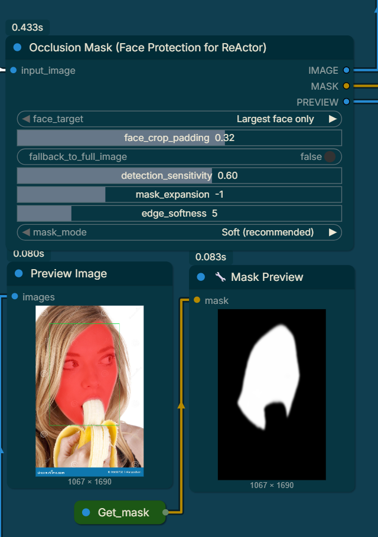

# OcclusionMask — Face Protection for ReActor

A ComfyUI custom node that solves one specific problem: **when you do a face swap and there's an object in front of the face — a microphone, a hand, sunglasses, food, anything — the swap normally overwrites those pixels too, erasing the object.**

This node generates a protection mask that tells ReActor *"don't touch these pixels"* so the object stays intact while the face swap happens normally everywhere else.

---

  

---

## What It Does

Before this node, swapping a face that has a microphone in front of it would erase the microphone and replace it with face skin. With this node in your workflow, the microphone is detected automatically and protected — the face swap happens on the visible face area only, and the microphone pixels are left exactly as they were in the original image.

It works with any object that is physically in front of the face:

- Microphones and boom mics
- Hands and fingers
- Sunglasses and regular glasses
- Food (a banana, a burger, a fork near the mouth)
- Scarves, masks, face coverings
- Props, signs, or anything someone is holding up near their face

---

## How It Works (Plain English)

The node runs two AI models on your image:

1. **The Occluder model** — trained to spot anything that is physically sitting in front of a face. It outputs a map of "something is covering the face here."

2. **The XSeg model** — trained to identify face skin specifically. It outputs a map of "this is actual face skin."

The node then combines them: the final protection mask covers pixels that the occluder flagged **and** that XSeg confirmed are *not* face skin. This two-step check is what makes it accurate — the occluder alone would sometimes flag cheeks or foreheads, but XSeg corrects that by saying "no, that's just skin, don't protect it."

---

## Setting Up Your Workflow

The node has three outputs. Wire them up like this:

```
[Load Image]
     │
     ▼
[OcclusionMask Node]
     │           │            │
   IMAGE        MASK        PREVIEW
     │           │            │
     └─────┬─────┘     [Preview Image]
           ▼           (for checking your settings)
       [ReActor]
           │
           ▼
    [Save Image / Preview]
```

- **IMAGE** → connect to ReActor's image input (it's a clean passthrough, the original is not modified)
- **MASK** → connect to ReActor's `face_mask` input
- **PREVIEW** → connect to a Preview Image node so you can see what's being protected (red overlay) and where the faces were detected (green boxes)

> **Important:** Always keep the Preview Image node connected while you're tuning settings. It shows you the red protection mask overlaid on your image in real time, so you can see exactly what ReActor will and won't touch before you run the swap.

---

## The Controls Explained

### Face Target
**"Largest face only"** or **"All faces"**

Use *Largest face only* for almost everything — it's faster and more accurate. Switch to *All faces* only when you have a group photo and multiple people all have objects in front of their faces. When *All faces* is selected, each face gets its own independent detection pass and the masks are combined.

---

### Face Crop Padding (0–50%)
*Default: 15%*

How much extra space around the detected face to include when running the models. The AI models see a slightly larger area than just the bare face bounding box, which helps catch objects near the edges of the face like earrings near the cheek or a mic near the chin.

**Leave this at 15% for most images.** Increase it to 25–35% if objects near the edges of the face (like a side-held microphone or a hand coming in from the side) are not being detected.

---

### Fallback to Full Image if No Face Found
*Default: Off*

If no face is detected in the image at all, this setting decides what happens. When **Off**, the node outputs an empty mask (no protection) and passes the image through unchanged. When **On**, the entire image is treated as the face region and the models run on the whole frame — useful if the face is very heavily covered and InsightFace can't find it.

**Leave this Off unless you're getting blank masks on images where you can clearly see a face.**

---

### Detection Sensitivity (0.0 – 1.0)
*Default: 0.65*

This is the most important slider. It controls how aggressively the node looks for objects in front of the face.

| Range | What it does | When to use it |
|---|---|---|
| 0.2 – 0.4 | Strict — only very obvious, large occlusions | A hand clearly covering most of the face |
| 0.5 – 0.7 | Balanced — good for most objects | Microphones, glasses, food, props |
| 0.8 – 1.0 | Sensitive — catches subtle or partially transparent occlusions | Thin objects, mesh, netting, light scarves |

If the protection mask is **spilling onto the face skin** (the red overlay is covering cheek or forehead areas it shouldn't), lower this value.

If the protection mask is **missing parts of the object** (the microphone head isn't fully covered by the red overlay), raise this value.

---

### Mask Expansion (-20 to +50 px)
*Default: +6*

Grows or shrinks the detected object mask after detection. Think of it as a safety margin.

A small positive value (+5 to +10) is almost always a good idea — it adds a few pixels of buffer around the detected object so that when ReActor does the swap, there's no thin ring of "leaked" swap pixels visible right at the object's edge.

**Use a negative value** (-5 to -15) only if the mask is bleeding into face skin that you want swapped. For example, if the mask is creeping up and covering the lips when you only want the microphone itself protected.

| Situation | Suggested value |
|---|---|
| Default / starting point | +6 |
| Object edges look blurry/haloed after swap | Increase to +10 – +15 |
| Mask is eating into the face | Decrease to 0 or go negative |
| Very small thin object (thin wire mic) | +3 – +5 |
| Large object (full hand, big prop) | +8 – +15 |

---

### Edge Softness (0 – 30 px)
*Default: 4*

Blurs the edges of the protection mask after it has been expanded. A soft edge creates a gradual blend between the protected object pixels and the swapped face pixels, which looks more natural than a hard cut.

- **0** — hard binary edge, the swap and the original meet at a sharp line. Can look unnatural but is useful if you're getting blurry seams.
- **4–8** — recommended for most use cases. Smooth, natural transition.
- **15–30** — very soft, wide feather. Use for transparent or semi-transparent objects like thin fabrics or hair.

---

### Mask Mode
**"Soft (recommended)"** or **"Hard (binary)"**

*Soft* keeps the mask as a gradient (values between 0 and 1) which allows partial blending at boundaries — the swap is 100% applied on clear face skin and gradually less applied near the edges of the object. This almost always looks better.

*Hard* makes the mask strictly 0 or 1 — a pixel is either fully protected or fully swapped. Use this if you're seeing ghosting or double-image artifacts at the object boundary with Soft mode.

---

## Settings for Common Scenarios

### Singer/Presenter with a Handheld Microphone
The mic head is usually large and round, partially overlapping the lower face.

| Setting | Value |
|---|---|
| Detection Sensitivity | 0.65 |
| Mask Expansion | +8 |
| Edge Softness | 5 |
| Mask Mode | Soft |

### Broadcaster with a Boom/Lavalier Mic Near the Face
Boom mics are often thin and positioned just off the mouth. Lavalier clips on clothing below the face.

| Setting | Value |
|---|---|
| Detection Sensitivity | 0.70 |
| Mask Expansion | +6 |
| Edge Softness | 4 |
| Mask Mode | Soft |

### Person Wearing Sunglasses
Glasses cover the eye area. The occluder model recognises frames and lenses.

| Setting | Value |
|---|---|
| Detection Sensitivity | 0.55 |
| Mask Expansion | +5 |
| Edge Softness | 4 |
| Mask Mode | Soft |

### Hand Partially Covering the Face
A hand over the mouth, fingers near the eyes, or a face-palm style pose.

| Setting | Value |
|---|---|
| Detection Sensitivity | 0.70 |
| Mask Expansion | +10 |
| Edge Softness | 6 |
| Mask Mode | Soft |

### Food / Object in the Mouth (Banana, Fork, etc.)
Object is directly at the mouth, partially inside and partially outside.

| Setting | Value |
|---|---|
| Detection Sensitivity | 0.60 |
| Mask Expansion | +8 |
| Edge Softness | 5 |
| Mask Mode | Soft |

### Scarf, Mask, or Face Covering
Fabric covering the lower half of the face. These can be tricky because fabric has soft edges.

| Setting | Value |
|---|---|
| Detection Sensitivity | 0.75 |
| Mask Expansion | +8 |
| Edge Softness | 10 |
| Mask Mode | Soft |

### Group Photo (Multiple Faces with Objects)
Use *All Faces* mode. Each face gets its own independent detection pass.

| Setting | Value |
|---|---|
| Face Target | All faces |
| Detection Sensitivity | 0.65 |
| Mask Expansion | +8 |
| Edge Softness | 5 |
| Mask Mode | Soft |

---

## Troubleshooting

**The red overlay in the preview isn't covering the object at all**
→ Raise Detection Sensitivity. Try 0.75–0.85. If it still doesn't work, increase Face Crop Padding — the object might be near the edge of the detected face region and getting cropped out before the models see it.

**The red overlay is covering parts of the face skin (cheeks, forehead, lips)**
→ Lower Detection Sensitivity. Try 0.45–0.55. If it's still happening, try a small negative Mask Expansion (-3 to -8) to trim the edges back.

**The swap result shows a visible seam or halo around the object**
→ Increase Mask Expansion by 3–5 px and raise Edge Softness by 2–3. The protected region needs a slightly bigger buffer.

**No face was detected (empty mask, swap runs on full face)**
→ InsightFace couldn't find a face. This happens with very heavy occlusion, unusual angles, or very small faces. Enable *Fallback to Full Image* to force the models to run anyway.

**The swap looks fine but the object has slight ghosting/double edge**
→ Switch Mask Mode from Soft to Hard. Some ReActor configurations blend differently with gradient masks.

**Processing is slow on a batch of images**
→ The models are loaded once and reused — the first image in a batch is slower than the rest. This is normal. Make sure your GPU is being used (CUDA should be auto-detected if available).

---

## Required Models

Place these files in the `models/` folder inside the node directory:

| File | Purpose |
|---|---|
| `occluder.onnx` | Detects objects in front of the face |
| `XSeg_model.onnx` | Identifies face skin region |
| `insightface/` folder | Face detection (InsightFace buffalo_l model) |

The InsightFace model will be downloaded automatically on first run if `INSIGHTFACE_HOME` is set, or if a valid path is found in the standard locations.

---

## Also Included: Batch Image Loader

The pack includes a **Batch Load Images** node that feeds a folder of images into the OcclusionMask node one by one. Connect its IMAGE output to the OcclusionMask IMAGE input. Useful for processing a video's extracted frames or a folder of photos in one workflow run.

---

## Credits

- [ComfyUI](https://github.com/comfyanonymous/ComfyUI) — The base UI and node framework.
- [insightface](https://github.com/deepinsight/insightface) — Face detection and recognition models.
- [DeepFaceLab](https://github.com/iperov/DeepFaceLab) — For XSeg and occluder models.
- [VisoMaster](https://github.com/visomaster/VisoMaster) - "Helper" functions adaptation. 
- [ReActor Custom Node](https://github.com/Gourieff/ComfyUI-ReActor) - Inspiration for this custom node.

---

## License
MIT License

---

Developed by ialhabbal

---

## Contributing

Contributions, suggestions, and improvements from the community are very welcome!

- Feel free to open issues for bugs, questions, or feature requests.
- Pull requests for new features, bug fixes, or documentation improvements are encouraged.
- Please follow standard open-source etiquette and provide clear commit messages.